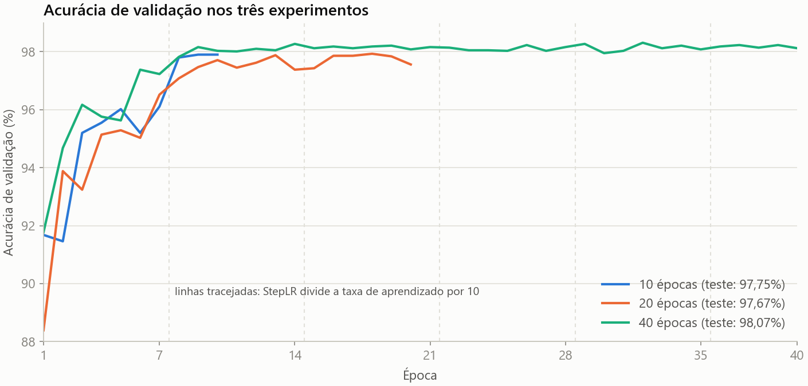
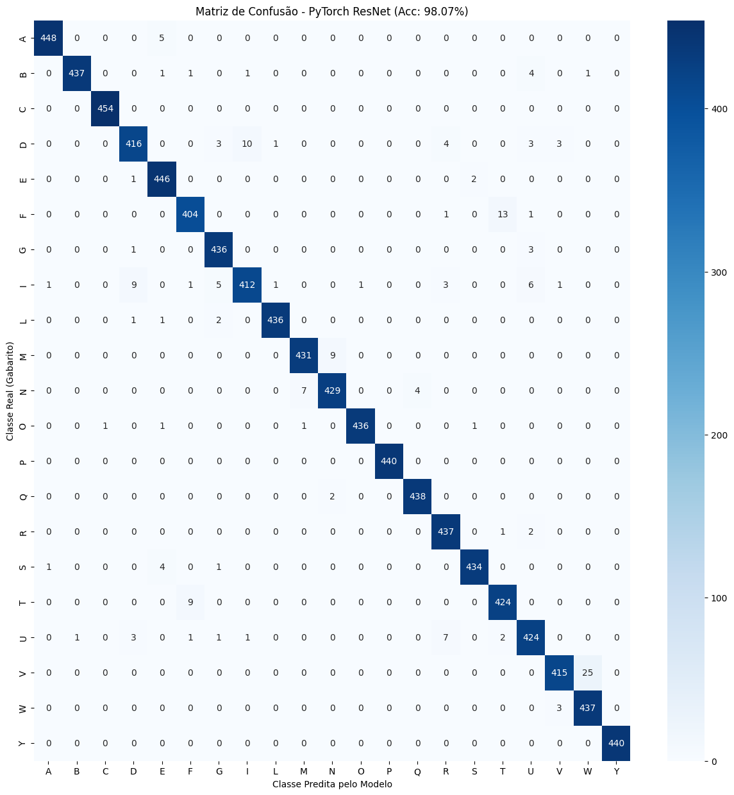
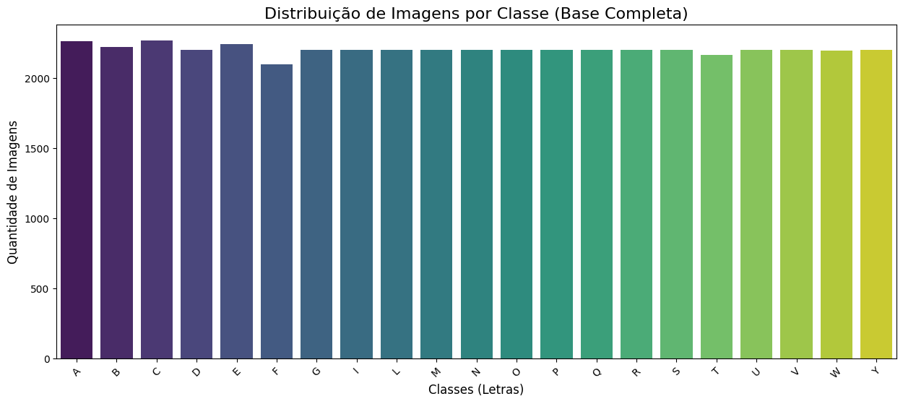

# Reconhecimento do alfabeto manual em Libras

Classificação de fotos de 21 letras do alfabeto manual da Libras com transfer learning a partir de uma ResNet-50, comparando treinos de 10, 20 e 40 épocas.

> Trabalho da disciplina *Tópicos Especiais em Matemática Aplicada: Deep Learning* (UnB, 2025), feito em grupo. Veja [Autores](#autores).

> ⚠️ **Leia as [limitações](#limitações-e-próximos-passos) antes dos números.** O split foi aleatório por imagem, então fotos muito parecidas, da mesma pessoa e sessão, podem estar no treino e no teste ao mesmo tempo. A acurácia abaixo provavelmente está inflada e não indica o desempenho com pessoas novas.

## Resultados

Teste com 9.253 imagens (20% do dataset), com os pesos da época de melhor acurácia de validação:

| Épocas | Melhor validação (época) | Acurácia no teste | F1 macro | Tempo de treino |
| :---: | :---: | :---: | :---: | :---: |
| 10 | 97,90% (9) | 97,75% | 0,98 | 13 min |
| 20 | 97,93% (18) | 97,67% | 0,98 | 25 min |
| 40 | 98,31% (32) | **98,07%** | 0,98 | 57 min |

**Como ler a tabela:** a diferença entre o melhor e o pior experimento é de 0,40 ponto percentual, cerca de 37 imagens em 9.253. Como os treinos não têm seed fixa e cada configuração rodou uma única vez, essa diferença pode ser ruído. As matrizes de 10 e 20 épocas estão em [`assets/`](assets/).

## O que aprendemos

- **Uma cabeça pequena bastou neste dataset.** Com a ResNet-50 congelada, treinamos só a nova cabeça, com cerca de 530 mil parâmetros, e a acurácia de validação ficou entre 88% e 92% já na primeira época.
- **Mais épocas não ajudaram de verdade.** O StepLR divide a taxa de aprendizado por 10 a cada 7 épocas: a partir da época 15, ela já é 100 vezes menor que a inicial, e a validação estabiliza em torno de 98%. Os 40 épocas custaram mais de quatro vezes o tempo do treino de 10 épocas, para uma diferença que pode ser ruído.
- **Validação acima do treino não é erro.** A acurácia de treino (cerca de 94% a 95%) fica abaixo da de validação porque o treino usa augmentation e dropout, e a validação não.
- **Os erros se concentram em formas de mão parecidas.** No experimento de 40 épocas, as maiores confusões são V → W (25 imagens), F → T (13), D → I (10), além de T → F, I → D e M → N (9 cada).
- **Acurácia alta pede desconfiança.** Os 98% motivaram a revisão do split, que é a principal limitação deste trabalho.

## Dataset

[LIBRAS CNN (allanpardinho/libras-cnn)](https://www.kaggle.com/datasets/allanpardinho/libras-cnn), no Kaggle: 46.262 imagens de 21 letras (A, B, C, D, E, F, G, I, L, M, N, O, P, Q, R, S, T, U, V, W e Y), com média de 2.203 imagens por letra (desvio-padrão de 34). As letras H, J, K, X e Z não estão no dataset. O download é feito no próprio notebook via `kagglehub`, e as imagens não são redistribuídas aqui.

A divisão é 70/10/20 (32.382 imagens de treino, 4.627 de validação e 9.253 de teste), estratificada por letra, aleatória por imagem e igual nos três experimentos (`random_state=42`).

## Abordagem

- **Modelo:** ResNet-50 pré-treinada na ImageNet, com todas as camadas congeladas e a camada final trocada por uma cabeça 2048 → 256 → 21, com ReLU e dropout de 0,3.
- **Treino:** Adam (lr 1e-3) só na cabeça, StepLR (÷10 a cada 7 épocas), batch 32 e imagens de 224×224, com rotação de até 15° e variação de cor no treino.
- **Seleção:** ao final, são restaurados os pesos da época com melhor acurácia de validação.
- **Execução:** Colab com GPU L4.

Os três notebooks, em [`notebooks/experiments/`](notebooks/experiments/), são idênticos, exceto pelo número de épocas. Eles guardam as saídas da execução original; para esta versão, foram removidos warnings, código duplicado e a amostra de imagens do dataset. A análise exploratória está só no de 10 épocas, e nenhum resultado foi alterado.

O código-base foi adaptado de [CNN Libras](https://www.kaggle.com/code/williansoliveira/cnn-libras), do usuário williansoliveira no Kaggle, que usa outro dataset.

## Fundamentos

Teoria resumida: Libras, CNN, ResNet e transfer learning

### Libras

A Língua Brasileira de Sinais é a língua visuoespacial da comunidade surda no Brasil, reconhecida pela Lei nº 10.436/2002, com gramática e vocabulário próprios. O alfabeto manual (datilologia) é usado para soletrar nomes e palavras sem sinal próprio. Algumas letras envolvem movimento e não podem ser reconhecidas por uma foto só.

### Redes convolucionais

Camadas de convolução aplicam filtros que detectam padrões locais, como bordas e texturas, e combinam esses padrões em representações cada vez mais abstratas. O pooling reduz a resolução e dá robustez a pequenos deslocamentos, e as camadas densas finais fazem a classificação.

### ResNet

Redes muito profundas sofrem com gradientes que desaparecem e com degradação do desempenho. A ResNet resolve isso com conexões residuais: cada bloco aprende a diferença `F(x) = H(x) − x` e soma a entrada à saída (`y = F(x) + x`), o que facilita a passagem do gradiente. A ResNet-50 tem 50 camadas.

### Transfer learning

Uma rede treinada na ImageNet já sabe extrair características visuais genéricas. Congelando essas camadas e treinando só uma nova cabeça para as 21 letras, o treino fica mais rápido, precisa de menos dados e reduz o risco de overfitting.

## Limitações e próximos passos

**Limitações**

- **Possível vazamento entre treino e teste (a mais importante):** o split é aleatório por imagem, e o código não usa nenhuma informação de pessoa ou sessão. As amostras mostram fundos, mãos e acessórios que se repetem, o que sugere várias fotos da mesma sessão. Se houver fotos da mesma pessoa ou do mesmo vídeo nos dois conjuntos, o modelo pode estar reconhecendo a sessão, e não a letra, e a acurácia fica inflada.
- **Sem teste externo:** não houve avaliação com pessoas, câmeras ou fundos que não estão no dataset.
- **Só letras estáticas:** 21 letras, de fotos isoladas e recortadas na mão; letras com movimento e a soletração contínua ficam de fora.
- **Ambiente controlado:** imagens de baixa resolução, com fundo simples e uma mão por foto, bem diferentes de uma câmera em uso real.
- **Variações não controladas:** cada configuração rodou uma vez, sem seed de treino, e o backbone ficou sempre congelado, sem fine-tuning.

**Próximos passos**

1. Refazer o split por pessoa ou sessão. Se o dataset não tiver essa informação, agrupar imagens quase idênticas (por hash perceptual ou similaridade de embeddings) e manter cada grupo em um único conjunto.
2. Montar um teste externo, com pessoas e fundos novos.
3. Comparar com fine-tuning do backbone e com modelos mais leves, pensando em uso em tempo real.
4. Adicionar detecção de mão (por exemplo, MediaPipe) antes da classificação.
5. Tratar as letras com movimento com modelos para vídeo.

## Autores

Eliseu Kadesh, Pedro Barbosa e Raquel Eucaria.

Trabalho desenvolvido em grupo na disciplina *Tópicos Especiais em Matemática Aplicada: Deep Learning*, ministrada pelo Prof. Vinicius Rispoli na Faculdade de Ciências e Tecnologias em Engenharia (UnB Gama), em 2025.

## Licença

O código deste repositório está sob a licença [MIT](LICENSE), que não cobre o dataset, os pesos pré-treinados nem o código-base de terceiros citado acima.

## Referências

- Dataset: [LIBRAS CNN](https://www.kaggle.com/datasets/allanpardinho/libras-cnn), Kaggle.
- Código-base: [CNN Libras](https://www.kaggle.com/code/williansoliveira/cnn-libras), Kaggle.
- He, K. et al. [Deep Residual Learning for Image Recognition](https://arxiv.org/abs/1512.03385). CVPR, 2016.
- Goodfellow, I.; Bengio, Y.; Courville, A. [Deep Learning](https://www.deeplearningbook.org/). MIT Press, 2016.
- LeCun, Y. et al. Gradient-based learning applied to document recognition. *Proceedings of the IEEE*, 1998.
- Yosinski, J. et al. [How transferable are features in deep neural networks?](https://arxiv.org/abs/1411.1792) NeurIPS, 2014.
- Brasil. [Lei nº 10.436, de 24 de abril de 2002](https://www.planalto.gov.br/ccivil_03/leis/2002/l10436.htm). Dispõe sobre a Língua Brasileira de Sinais.
